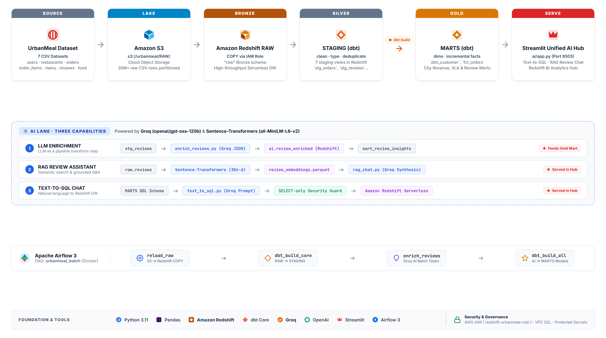

# UrbanMeal AI Data Engineering — End-to-End Project (AWS Redshift Edition)

## 📖 Project Overview
This project presents an enterprise-grade batch data pipeline that processes UrbanMeal food delivery data from raw CSV files into an AI-powered analytics platform built entirely on **Amazon Web Services (AWS)** and modern data stack tools.

The dataset lands in an **Amazon S3 data lake** and is ingested directly into **Amazon Redshift** (Serverless or Provisioned) via high-performance `COPY` commands using native AWS IAM role authentication. From there, `dbt` transforms the data through a Medallion Architecture (Raw, Staging, Marts). **Apache Airflow 3** orchestrates the entire pipeline through a scheduled DAG. Finally, an **AI layer** powered by OpenAI enriches customer reviews with sentiment & topics, provides a RAG-based chat interface for reviews, and enables a natural-language Text-to-SQL interface for querying your Redshift data warehouse.

### 🌟 Key Features
- **100% AWS-Native Architecture**: Fully powered by Amazon S3 & Amazon Redshift—optimized for leveraging AWS free-tier and promotional credits.
- **Automated Data Pipeline**: Orchestrated by Apache Airflow 3 via Docker with native Redshift operators.
- **Medallion Architecture**: RAW (Bronze), STAGING (Silver), and MARTS (Gold) modeled using `dbt` (`dbt-redshift`).
- **High-Throughput Ingestion**: Parallel S3 `COPY` into Redshift with error-handling for messy real-world dimension data.
- **AI-Enrichment**: Analyzes free-text reviews for sentiment, category topics, and issues using OpenAI LLMs.
- **Interactive Streamlit Apps**:
  - **RAG Chat with Reviews**: Vector similarity search + LLM synthesis on customer reviews.
  - **Text-to-SQL Warehouse Chat**: Natural language to Redshift SQL query generator and visualizer.
- **Secure IAM Role Handshake**: Direct AWS service trust (`redshift.amazonaws.com`) without hardcoded credentials.

---

## 🏗️ Architecture & Tech Stack



**Pipeline Flow:** UrbanMeal CSVs → Amazon S3 → Amazon Redshift (Bronze) → dbt Core (Silver/Gold) → Apache Airflow 3 → Groq AI Layer → Streamlit Unified Hub

- **Storage & Data Warehouse:** Amazon S3, Amazon Redshift Serverless
- **Data Transformation:** dbt Core (`dbt-redshift`)
- **Pipeline Orchestration:** Apache Airflow 3 (Docker Compose)
- **AI & LLM Stack:** Groq (`openai/gpt-oss-120b`), Sentence-Transformers (`all-MiniLM-L6-v2`), OpenAI API compatible
- **Analytics & BI Frontend:** Streamlit Unified Portal (`ai/app.py`), Plotly, Pandas, `redshift-connector`

---

## 📁 Repository Structure
```text
├── airflow/                     # Airflow 3 on Docker (Amazon/Redshift providers)
│   ├── Dockerfile               # Custom image with dbt-redshift & redshift-connector
│   ├── docker-compose.yaml      # Postgres + API Server + Scheduler + DAG Processor
│   ├── example.env              # Environment variables template for Redshift & OpenAI
│   └── dags/urbanmeal_batch.py  # End-to-end daily batch pipeline DAG
├── urbanmeal/                   # dbt project (Medallion models & macros)
│   ├── dbt_project.yml          # Project configuration
│   ├── profiles.yml             # Redshift profile configuration (reads env vars)
│   ├── macros/                  # Custom schema resolution macros
│   └── models/                  # Staging and Marts models (Redshift-compatible SQL)
├── ai/                          # AI Layer & Streamlit Applications
│   ├── app.py                   # Unified Streamlit Hub (Text-to-SQL + RAG + Redshift BI)
│   ├── requirements.txt         # Python dependencies for the AI layer
│   ├── example.env              # Local .env template
│   ├── enrich_reviews.py        # Groq batch sentiment & topic classification
│   ├── rag_chat.py              # Streamlit RAG review assistant with embeddings
│   └── text_to_sql.py           # Streamlit Text-to-SQL for Redshift
├── redshift/                    # Amazon Redshift Setup & DDL Scripts
│   ├── 01_setup.sql             # Schemas (raw, staging, marts, ai, snapshots) & permissions
│   ├── 02_iam_role.md           # Step-by-step IAM role creation & attachment guide
│   ├── 03_raw_tables.sql        # Redshift DDL for the 7 raw tables
│   └── 04_copy_into.sql         # High-speed COPY commands from S3 to Redshift
├── aws/iam/                     # IAM Policy Templates
│   ├── redshift-role-trust-policy.json  # Redshift trust policy
│   └── s3-read-policy.json              # S3 bucket read permissions policy
└── docs/architecture.png        # Architecture diagram
```

---

## 📂 Dataset
> [Download the CSV files here](https://drive.google.com/drive/folders/1FEnGWMHhHzzTUCZOw1-YnH2v3DMuM-rs?usp=sharing) and place them in your S3 bucket.

The dataset includes:
- **Dimensions:** Restaurants (~148K rows), Users, Food items, Menu items.
- **Facts:** Orders (~10M rows), Order items (~23M rows), Customer reviews (~300K rows).

---

## 🚀 Setup & Running Instructions

### Prerequisites
- AWS Account (with S3 and Amazon Redshift access)
- Docker & Docker Compose
- Python 3.10+
- OpenAI API Key

---

### Step 1: S3 Bucket Setup & Data Upload
Your dataset CSVs are stored in S3 at:
```text
s3://urbanmeal/RAW/food.csv
s3://urbanmeal/RAW/menu (1).csv
s3://urbanmeal/RAW/order_items.csv
s3://urbanmeal/RAW/orders.csv
s3://urbanmeal/RAW/restaurant.csv
s3://urbanmeal/RAW/reviews.csv
s3://urbanmeal/RAW/users.csv
```

---

### Step 2: Redshift IAM Role Setup
Follow [redshift/02_iam_role.md](file:///c:/Users/nehau/Downloads/zomato-ai-data-engineering-end-to-end-project-main/zomato-ai-data-engineering-end-to-end-project-main/redshift/02_iam_role.md):
1. Create an IAM Role named `redshift-urbanmeal-role` in the AWS IAM Console.
2. Under **Trust relationships**, verify it trusts `redshift.amazonaws.com` (see [redshift-role-trust-policy.json](file:///c:/Users/nehau/Downloads/zomato-ai-data-engineering-end-to-end-project-main/zomato-ai-data-engineering-end-to-end-project-main/aws/iam/redshift-role-trust-policy.json)).
3. Attach policy `AmazonS3ReadOnlyAccess` (or the inline policy in [s3-read-policy.json](file:///c:/Users/nehau/Downloads/zomato-ai-data-engineering-end-to-end-project-main/zomato-ai-data-engineering-end-to-end-project-main/aws/iam/s3-read-policy.json)).
4. Associate `redshift-urbanmeal-role` with your Redshift cluster or Serverless namespace.
5. Note the Role ARN (e.g., `arn:aws:iam::123456789012:role/redshift-urbanmeal-role`).

---

### Step 3: Redshift Database Setup & Ingestion
Open **Amazon Redshift Query Editor v2** in the AWS Console:
1. Run [01_setup.sql](file:///c:/Users/nehau/Downloads/zomato-ai-data-engineering-end-to-end-project-main/zomato-ai-data-engineering-end-to-end-project-main/redshift/01_setup.sql) to create the schemas (`raw`, `staging`, `marts`, `ai`, `snapshots`).
2. Run [03_raw_tables.sql](file:///c:/Users/nehau/Downloads/zomato-ai-data-engineering-end-to-end-project-main/zomato-ai-data-engineering-end-to-end-project-main/redshift/03_raw_tables.sql) to define the raw table structures.
3. Open [04_copy_into.sql](file:///c:/Users/nehau/Downloads/zomato-ai-data-engineering-end-to-end-project-main/zomato-ai-data-engineering-end-to-end-project-main/redshift/04_copy_into.sql), replace `<YOUR_BUCKET>` and `<YOUR_ROLE_ARN>`, and execute the script to load all CSVs into Redshift.

---

### Step 4: Transformation with dbt
1. Navigate to the `urbanmeal` dbt directory:
   ```bash
   cd urbanmeal
   ```
2. Set your Redshift connection details in your terminal:
   ```bash
   # On Windows (PowerShell):
   $env:REDSHIFT_HOST="your-redshift-endpoint.redshift.amazonaws.com"
   $env:REDSHIFT_PORT="5439"
   $env:REDSHIFT_DATABASE="dev"
   $env:REDSHIFT_USER="awsuser"
   $env:REDSHIFT_PASSWORD="YourPassword123!"

   # On Linux/macOS:
   export REDSHIFT_HOST="your-redshift-endpoint.redshift.amazonaws.com"
   export REDSHIFT_PORT="5439"
   export REDSHIFT_DATABASE="dev"
   export REDSHIFT_USER="awsuser"
   export REDSHIFT_PASSWORD="YourPassword123!"
   ```
3. Test connectivity and run the transformations:
   ```bash
   dbt debug
   dbt build --exclude tag:ai
   ```

---

### Step 5: Orchestration with Apache Airflow
1. Navigate to the `airflow/` directory:
   ```bash
   cd airflow
   ```
2. Create your `.env` file from the template:
   ```bash
   cp example.env .env
   ```
3. Fill in your `REDSHIFT_*`, `REDSHIFT_ROLE_ARN`, `S3_BUCKET`, and `OPENAI_API_KEY` in `.env`.
4. Build and start the Airflow containers:
   ```bash
   docker compose build
   docker compose up -d
   ```
5. Open the Airflow web UI at `http://localhost:8080` (Username: `admin`, Password: `admin`).
6. Unpause the `urbanmeal_batch` DAG and trigger a manual run!

---

### Step 6: Run the Unified AI Analytics Hub (Streamlit + Groq)
1. Install dependencies:
   ```bash
   pip install -r ai/requirements.txt
   ```
2. Configure `ai/.env` with your `REDSHIFT_*` credentials and `GROQ_API_KEY`.
3. **Launch the Unified Dashboard**:
   ```bash
   streamlit run ai/app.py
   ```
   *(Combines Text-to-SQL, RAG Review Chat, and Redshift BI Analytics into a single URL!)*

---

## 💡 AWS Credits & Cost Optimization Tips
- **Redshift Serverless**: If you are using Serverless, set the **Base Capacity** to 8 RPU (the lowest setting) to maximize your AWS credits.
- **Provisioned Cluster**: If using a provisioned cluster (such as `dc2.large`), remember to **pause** the cluster in the AWS console when you are not actively working on it.
- **S3 Storage Class**: Use S3 Standard for initial loading, and transition raw folders to S3 Standard-IA if keeping long-term.
